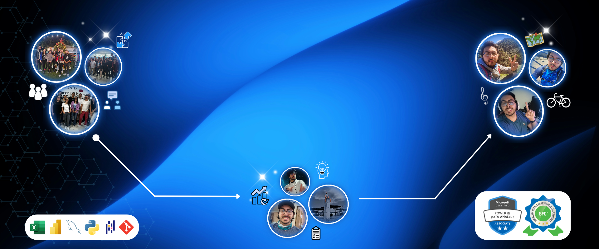
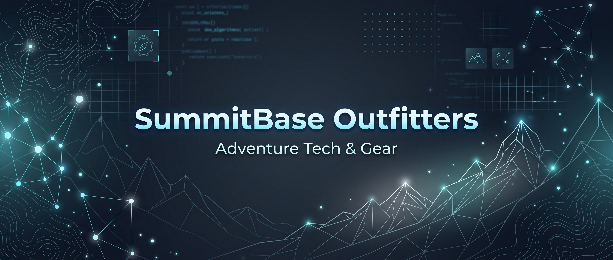

<div align="center">

  # 🌐 Kevinrn.com — Kevin Robles | Personal Website & Portfolio

  [](https://www.kevinrn.com)
  [](https://www.linkedin.com/in/krobles-info/)
  [](https://github.com/Kevinrn-info)
  [](https://drive.google.com/drive/folders/1ybV7h86U72G7GYlvESibLg-fDu3-b4Iu?usp=sharing)

  <br>

  <!-- Portada Principal de Kevinrn.com -->
  

  *Official repository for **[Kevinrn.com](https://www.kevinrn.com)** — the personal website and professional portfolio of **Kevin Robles**, Analytics Data Engineer & Technical Team Lead.*

</div>

---

## 📋 Table of Contents

1. [About Kevinrn.com (Website Overview)](#-about-kevinrncom-website-overview)
2. [Website Architecture & Pages](#-website-architecture--pages)
3. [Professional Profile, Skills & Services](#-professional-profile-skills--services)
4. [Featured Project for Recruiters: SummitBase Outfitters](#-featured-project-for-recruiters-summitbase-outfitters)
   - [Business Case & Dataset Metrics](#️-business-case--dataset-metrics)
   - [Project Technology Stack](#️-project-technology-stack)
   - [The 7-Phase Engineering Workflow](#️-the-7-phase-engineering-workflow)
   - [Deliverables & Documentation](#-deliverables--documentation)
5. [Repository Structure](#-repository-structure)
6. [Local Setup & Deployment](#-local-setup--deployment)
7. [Contact & Links](#-contact--links)

---

## 🖥️ About Kevinrn.com (Website Overview)

**Kevinrn.com** is a responsive, multi-page personal website built to present the professional trajectory, technical competencies, leadership background, and engineering services of **Kevin Robles**.

### Frontend & UI Stack
- **Core:** HTML5, CSS3 (Custom properties & responsive layouts), JavaScript (ES6)
- **Framework & Icons:** Bootstrap 5.3, Bootstrap Icons
- **Interactive Libraries:**
  - **AOS (Animate On Scroll):** Smooth section and card entrance animations
  - **PureCounter:** Animated KPI and metric counters
  - **Swiper.js:** Touch-enabled carousels for team testimonials and galleries
  - **GLightbox:** Fullscreen image and technical capture inspection
  - **Isotope & ImagesLoaded:** Filterable masonry layouts for technical portfolio items

---

## 🗺️ Website Architecture & Pages

| Page | File | Description |
| :--- | :--- | :--- |
| **Home** | [`index.html`](index.html) | Main hero cover (`hero-bg.jpg`) introducing Kevin Robles as a professional Analytics Data Engineer with direct access to his profile. |
| **About** | [`about.html`](about.html) | Academic foundation (TEC & Universidad Fidélitas), personal & professional bio, technical skill progress bars, career impact metrics at Servicios PSI Internacional S.A. (`14` U.S. states, `8` processes, `650,000` miles of roadway analyzed, `10` team members), and staff testimonials. |
| **Resume** | [`resume.html`](resume.html) | Interactive CV detailing education, work experience (*Team Lead Manager*, *Lead Trainer*, *Operator & High Quality Images Assurance*), and direct download of [`Kevin_Robles-Data_Analyst-Resume_EN.pdf`](assets/resume/Kevin_Robles-Data_Analyst-Resume_EN.pdf). |
| **Services** | [`services.html`](services.html) | Professional services offered: *Data Quality Assurance*, *ETL Pipeline Automation*, *Business Intelligence & Reporting*, *Data Modeling & Architecture*, *Technical Team Leadership*, and *Technical Training & Documentation*. |
| **Project** | [`project.html`](project.html) | Dedicated showcase page for the flagship **SummitBase Outfitters** data engineering & BI project. |
| **Portfolio** | [`portfolio.html`](portfolio.html) | Filterable masonry gallery of specialized projects across Power BI, Advanced Excel, Python (Pandas), Descriptive Statistics, Graphs & Visualizations, n8n, Docker, Git, Scrum, UX/UI, and English. |
| **Contact** | [`contact.html`](contact.html) | Direct contact channels (Cartago, Costa Rica, WhatsApp, Email), embedded Google Map, and contact form. |

---

## 👨‍💻 Professional Profile, Skills & Services

**Kevin Robles** is an **Analytics Data Engineer & Technical Team Lead** specialized in designing, building, optimizing, and maintaining robust data pipelines and storage architectures (Data Warehouses and Data Lakehouses), transforming raw operational data into clean, modeled, high-quality datasets for strategic decision-making.

### Technical Skills Highlighted on the Website
- **Power BI (100%)** — DAX, Power Query, interactive executive dashboards, and `.pbip` / TMDL version control
- **SQL / PostgreSQL (90%)** — Complex queries, relational modeling, Star & Snowflake schemas, MySQL
- **SCRUM / Agile (85%)** — Technical team leadership, sprint planning, cross-functional KPI alignment
- **Python (75%) & Data Storytelling (75%)** — Pandas, NumPy, Matplotlib, EDA, automated ETL scripts, Looker & Tableau
- **Git / Docker (70%), Databricks (65%) & CI/CD (60%)** — Containerized environments, repository governance, Pathway stream processing, and n8n workflow automation

---

## 🚀 Featured Project for Recruiters: SummitBase Outfitters

<div align="center">

  

  *End-to-End Data Lifecycle, Business Intelligence & AI Integration — Featured on [`project.html`](project.html)*

</div>

<br>

> **💡 Note for Recruiters & Hiring Managers:**  
> To demonstrate how my technical and leadership skills translate into a real-world corporate environment, I built the **SummitBase Outfitters** capstone project (available in the [`Project`](project.html) section of the website and in the [`Engineering-Data-Analysis_Sales-Overview`](https://github.com/Kevinrn-info/Engineering-Data-Analysis_Sales-Overview) repository). It goes beyond isolated scripts to showcase **end-to-end data governance, containerized infrastructure, automated ETL workflows, version-controlled BI (`.pbip`), UX/UI design, and modern AI integration**.

### 🏔️ Business Case & Dataset Metrics

**SummitBase Outfitters** is a fictional e-commerce and inventory management platform for mountaineering, camping, and outdoor exploration gear. The relational database spans **7 core tables** (`products`, `customers`, `orders`, `order_items`, `payments`, `shipments`, and `returns`), analyzing inventory margins (`unit_cost` vs. `unit_price`), acquisition channels, and weight-based shipping logistics:

| Metric | Volume | Business & Analytical Scope |
| :--- | :---: | :--- |
| **Outdoor Gear Catalog (`products.csv`)** | **1,500** | SKUs with cost margins (`unit_cost` vs. `unit_price`), categories & weight logistics |
| **Customer Profiles (`customers.csv`)** | **26,000** | Global customer base, loyalty tiers, and marketing opt-in validation |
| **Orders & Payments (`orders.csv` / `payments.csv`)** | **90,000+** | Multi-channel transactions (`app`, `web`, `marketplace`) with normalized Date/Time |
| **Logistics & Returns (`shipments.csv` / `returns.csv`)** | **83,885 / 8,000** | Carrier tracking (FedEx, DHL, UPS, Royal Mail), `in_transit` status & return audits |

### 🛠️ Project Technology Stack

| Category | Technologies |
| :--- | :--- |
| **Infrastructure & Setup** |  Docker &nbsp;•&nbsp;  Git &nbsp;•&nbsp;  SQL |
| **Data Processing & Python** |  Python &nbsp;•&nbsp;  Pandas &nbsp;•&nbsp;  Jupyter Notebooks &nbsp;•&nbsp;  Anaconda |
| **Automation, IDE & Testing** |  VS Code &nbsp;•&nbsp; ⚡ n8n Workflow Automation &nbsp;•&nbsp; ✅ Unit Testing (`pytest`) |
| **BI, Governance, UX/UI & AI** |  Power BI (`.pbip` / TMDL / PBIR) &nbsp;•&nbsp;  Canva &nbsp;•&nbsp; 🤖 Gemini AI LLMs |

### ⚙️ The 7-Phase Engineering Workflow

1. **Environment & Infrastructure Setup:** Configured Git version control with strict `.gitignore` rules, containerized the environment with **Docker**, and connected a relational **SQL database**.
2. **Professional Scrum-Agile Workflow:** Executed sprint planning, task tracking, security policies, and modular separation of concerns (`src/`, `sql/`, `tests/`, `data/`, `dags/`, `docs/`, `notebooks/`).
3. **IDE Configuration & Deterministic Testing:** Optimized **Visual Studio Code** for Python pipelines and text-based Power BI project files (`.pbip`), implementing **Unit Tests** to guarantee data integrity before processing.
4. **Data Extraction & Automation (n8n):** Designed a complete workflow diagram and implemented an automated **n8n** pipeline to centralize the data hub and schedule recurring updates.
5. **Data Cleaning, Profiling & Rapid Visualization:** Used **Python, Anaconda, Jupyter Notebooks, Pandas**, and **Power Query** (profiling 100% of rows rather than 1,000-row samples) to handle missing values, validate `in_transit` null delivery timestamps, and split `order_date` into granular `Date` and `Time` columns.
6. **Business Intelligence, PBIP Governance & Security:** Designed an interactive **Power BI Dashboard** stored in `.pbip` format, serializing the semantic model (`TMDL`) and visual report (`PBIR`) for true Git version control, paired with UX/UI principles and a stakeholder presentation in **Canva**.
7. **🧠 AI Integration (Standout Feature):** Authored structured, AI-readable Markdown context files (`For_AI.md` and module documentation) and integrated **Gemini AI** inside VS Code so LLMs can comprehend repository lineage and assist in generating advanced analytical insights.

### 📦 Deliverables & Documentation

Recruiters and technical evaluators can inspect all project artifacts directly from [`project.html`](project.html):
- 💻 **Project Source Repository:** [Engineering-Data-Analysis_Sales-Overview on GitHub](https://github.com/Kevinrn-info/Engineering-Data-Analysis_Sales-Overview)
- 📄 **Architecture Action Plan (PDF):** [`assets/project/Data_Analysis_Project_Plan.pdf`](assets/project/Data_Analysis_Project_Plan.pdf)
- 📝 **Data Cleaning & Process Documentation (DOCX):** [`assets/project/SummitBase_Documentation.docx`](assets/project/SummitBase_Documentation.docx)
- 📊 **Power BI Semantic Model & Report:** Version-controlled `.pbip` (`TMDL` / `PBIR`) and `Project.pbix`

---

## 📂 Repository Structure

```text
Kevinrn/
├── index.html                  # Home / Main hero cover page (hero-bg.jpg)
├── about.html                  # Biography, technical skills, PSI impact stats & testimonials
├── resume.html                 # Academic background, work experience & PDF resume link
├── services.html               # Data Engineering & BI services offered
├── project.html                # SummitBase Outfitters capstone project showcase & deliverables hub
├── portfolio.html              # Filterable masonry portfolio of technical modules
├── contact.html                # Contact information, WhatsApp link, Google Map & form
├── portfolio-details/          # Individual detail pages for portfolio items (Power BI, Python, Docker, etc.)
└── assets/
    ├── css/
    │   └── main.css            # Global styles + custom SummitBase Outfitters project showcase styles
    ├── js/
    │   └── main.js             # Initialization for AOS, Swiper, GLightbox, Isotope & PureCounter
    ├── img/
    │   ├── hero-bg.jpg         # Main website cover image
    │   ├── project/            # SummitBase Outfitters banner, Power Query & Gemini AI captures
    │   ├── masonry-portfolio/  # Thumbnails for portfolio categories
    │   └── testimonials/       # Team member profile photos
    ├── project/
    │   ├── Data_Analysis_Project_Plan.pdf      # 21-page Data Engineering Architecture Plan
    │   └── SummitBase_Documentation.docx       # Step-by-step data cleaning & AI setup documentation
    ├── resume/
    │   └── Kevin_Robles-Data_Analyst-Resume_EN.pdf
    └── vendor/                 # Bootstrap, Bootstrap Icons, AOS, Swiper, GLightbox, Isotope, PureCounter
```

---

## ⚡ Local Setup & Deployment

1. **Clone the repository:**
   ```bash
   git clone https://github.com/Kevinrn-info/Kevinrn.git
   cd Kevinrn
   ```
2. **Preview locally:**
   Open `index.html` directly in your browser, or launch with VS Code **Live Server** (`http://127.0.0.1:5500/index.html`).

---

## 🤝 Contact & Links

I am always open to new challenges and opportunities in Data Engineering, Analytics, and Business Intelligence. Feel free to connect!

- 🌐 **Website:** [https://www.kevinrn.com](https://www.kevinrn.com)
- 💼 **LinkedIn:** [linkedin.com/in/krobles-info](https://www.linkedin.com/in/krobles-info/)
- 🐙 **GitHub:** [github.com/Kevinrn-info](https://github.com/Kevinrn-info)
- ✉️ **Email:** [krobles.info@gmail.com](mailto:krobles.info@gmail.com)
- 📱 **WhatsApp / Phone:** [+506 8658 7630](https://api.whatsapp.com/send?phone=50686587630)
- 📍 **Location:** Cartago, Costa Rica
